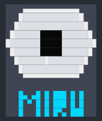
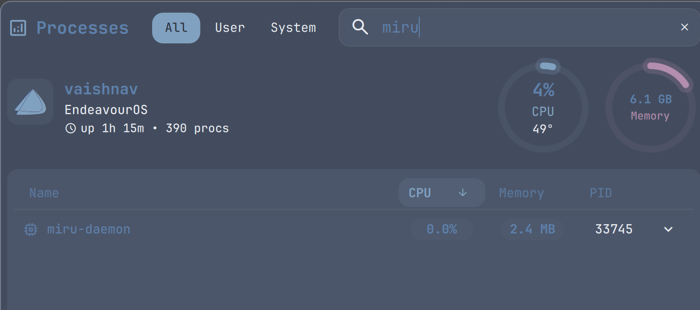

# Miru

 

  

 
 

  
  

 

> [!IMPORTANT]
> Development is done on
> [Codeberg](https://codeberg.org/Vaishnav-Sabari-Girish/miru) with a mirror in
> [GitHub](https://github.com/Vaishnav-Sabari-Girish/miru) You can report issues
> and discuss them on GitHub, no Codeberg account needed. Issues opened on
> GitHub are automatically mirrored to Codeberg as locked, read-only copies that
> are used only for tracking (labels, milestones). Comments you add on the
> GitHub issue are copied across, and closing or reopening an issue on either
> side is reflected on the other (Codeberg -> GitHub closes can take up to ~15
> minutes).

Please keep the conversation on the GitHub issue. Comments made on the Codeberg
copy are not synced back.

A Wayland-native screen magnifier and cursor spotlight tool for streamers, built
for Wayland compositors supporting the required wlroots protocols. Miru is
primarily developed and tested on Niri.

Inspired by [boomer](https://github.com/tsoding/boomer), but for Wayland —
written in C, keybind-driven, no GUI, no mouse-required config.

See [Roadmap](./ROADMAP.md) for the full picture.

> [!IMPORTANT]
> Miru currently requires both `wlr-layer-shell-unstable-v1` and
> `wlr-screencopy-unstable-v1`. Compositors that do not expose these protocols
> are not currently supported.
>
> In particular, **GNOME (Mutter)** and **KDE Plasma (KWin)** are not supported
> at this time.

> [!NOTE]
> `miru` devlogs on YouTube
> <https://youtube.com/playlist?list=PLZraydlsV2t0&si=jystH8Ik1UjDVu5t>

## Demo

## Table of contents

* [What it does](#what-it-does)
* [Why](#why)
* [Compositor Compatibility](./INSTALL.md#compositor-compatibility)
* [Performance](#performance)
* [A note on global hotkeys](#a-note-on-global-hotkeys)
* [Requirements](./INSTALL.md#requirements)
* [Installing](./INSTALL.md#installing)
* [Building](./INSTALL.md#building)
* [Running](./RUNNING.md#running)
* [Man pages](./RUNNING.md#man-pages)
* [Configuration](./CONFIGURATION.md#configuration)
* [Keybinds](./KEYBINDS.md#setting-up-a-keybind)
* [Project structure](./PROJECT_STRUCTURE.md#project-structure)
* [Roadmap](./ROADMAP.md#roadmap)
* [Similar tools](#similar-tools)
* [License](#license)
* [Contributing](#contributing)

### What it does

* **Magnifier mode** — press a key, the screen freezes into a zoomed-in
  fullscreen view centered on your cursor (or the last known pointer position
  from a previous session in the same daemon run). Move the mouse to pan,
  scroll or press +/- to adjust zoom, use arrow keys or WASD to pan by
  keyboard, press Esc (or the toggle key again) to exit. Like `boomer`, but
  native Wayland.

  While active:

  * **Tab** toggles **Cursor Highlight** — darkening everything except a
    soft-edged circle that follows the real pointer (absolute tracking), even
    when zoomed. Configurable via `[spotlight]`. Radius can be adjusted live
    with **Shift+Plus/Minus** or **Ctrl+scroll**. Entry/exit of the highlight
    is animated (`spotlight.animation_speed`).
  * **Shift+A** toggles **Annotate mode** — pan freezes and you can draw
    presentation shapes on the frozen frame (arrows, rectangles, lines, ellipse
    and circle). Defaults (tool, colors, thickness, text size) are configurable
    under `[annotate]`. See controls below.
  * **F** cycles between different image filters (inverted, grayscale, contrast,
    default).
  * **Shift+H** or **?** toggles an on-screen **help panel** listing the
    current keybinds (Esc closes help first, then exits the magnifier).
  * **Shift+E** exports the current view to a `.png` or `.bmp` file which is
    created at `$HOME/Pictures/miru/` (Check out
    [`test_export.png`](./test_export.png) and
    [`test_export.bmp`](./test_export.bmp))

  Cursor Highlight, annotations, export, and help only work *inside* an active
  Magnifier session; the desktop underneath stays frozen/grabbed while the
  overlay is on. **Built and working now.**

* **Loupe Mode**: `miructl loupe` freezes the screen the same way as
  `miructl toggle`, then lets you drag a rectangle over an area. After release,
  only the selected region is zoomed in a fixed-size window that follows the
  cursor; the rest of the frame stays at 1x. The selection shape is configurable
  (`[loupe] shape`: `"rectangle", "ellipse" or "circle"`. Scroll to change loupe
  zoom. Toggle again (or quit) to exit. Separate from the above
  **Magnifier Mode**. **Requires a separate compositor keybind**.

* **Spotlight mode** — a fully independent, click-through overlay that darkens
  the whole screen except a cursor-tracking circle, while you keep working
  normally underneath — no freeze, no input grab, usable during normal desktop
  work rather than only inside a Magnifier session. This is a different, harder
  problem than Cursor Highlight above: it needs cursor tracking without stealing
  pointer/keyboard focus, which Cursor Highlight sidesteps entirely by already
  owning input while Magnifier is active. **Work In Progress. (Mode is
  implemented, but cursor follow through is a WIP)**

### Why

Most screen magnifiers either don't exist for Wayland, or route through XWayland
with visible artifacts and no compositor integration. Miru uses Wayland
protocols directly, currently relying on `wlr-layer-shell` for its overlay and
`wlr-screencopy` for screen capture. The overlay itself is rendered with
OpenGL ES 2 via EGL.

### Performance

Because there's no continuous re-capture while the overlay is inactive (see
[Setting up a keybind](./KEYBINDS.md#setting-up-a-keybind) for why),
`miru-daemon`
sits completely idle — blocked in `poll()` waiting for either a Wayland event
or a toggle command — for as long as you're not actively using it. In
practice this means ~0% CPU usage at rest:

  

### A note on global hotkeys

Miru is toggled via a compositor-level keybind (see [Setting up a
keybind](./KEYBINDS.md#setting-up-a-keybind)), not an in-app global hotkey —
and
this is deliberate, not a missing feature. Wayland's security model doesn't
allow any client to listen for keypresses while it isn't focused; only the
compositor itself has that privileged access, which is exactly why every
Wayland compositor provides *some* way to bind a key to a command (a config
file, or a GUI).

Routing through the compositor is the correct, secure way to do this — the
alternative (a client reading raw kernel input events directly, bypassing
Wayland's input model) means running with elevated device permissions and
having the daemon read every keystroke on your system at all times just to
catch one hotkey, which is a meaningfully bigger trust ask than this project
wants to make for a screen-zoom tool.

### Similar tools

1. [`woomer`](https://github.com/coffeeispower/woomer) — `boomer` for
   Wayland, written in Rust (uses `raylib`)
2. [`hyprmagnifier`](https://github.com/st0rmbtw/hyprmagnifier) — a
   wlroots-compatible Wayland magnifier that does not suck
3. [`cboomer`](https://github.com/laserattack/cboomer) — a port of `boomer`
   written in C
4. [`cboomer` (DavidBalishyan)](https://github.com/DavidBalishyan/cboomer) —
   a different port of `boomer`, also written in C
5. [`zoomer`](https://codeberg.org/imal/zoomer) — a port of `boomer` written
   in Zig, with Wayland support and an X11 fallback

### License

See [LICENSE](./LICENSE).

### Contributing

See [CONTRIBUTING.md](./CONTRIBUTING.md)

## 🧠 (mostly) Brain made

**This project was NOT vibe-coded BUT AI is still involved in some parts of
it.**

* **Micro-improvements:** I have used AI as an advisor to improve some bits of
  code here and there. Big refactors or new features are done by my hand though.

 

